# Camp-Bath

**キャンプ場と周辺施設をまとめて検索し、キャンプ計画をスムーズにするWebアプリケーション**

[](https://camp-bath.onrender.com/)

**アプリURL：** https://camp-bath.onrender.com/
## 1. サービス概要

Camp-Bathは、キャンプ場とその周辺にある温泉・商業施設などを地図上で検索し、施設情報や移動距離・所要時間をまとめて確認できるWebアプリケーションです。

キャンプの計画では、キャンプ場の情報だけでなく、周辺の温泉の営業時間や買い出し先なども調べる必要があります。複数のサービスを行き来して情報を確認する手間を減らし、キャンプ場と周辺施設の位置関係を直感的に把握できることを目指しました。

ログインせずに施設検索を利用でき、ログインするとキャンプ場と温泉の組み合わせをお気に入りとして保存できます。

## 2. 開発背景・解決したい課題

自身がキャンプを計画した際、キャンプ場の受付時間と周辺温泉の営業時間を別々に調べる必要があり、情報を何度も確認する手間がありました。

キャンプ場を決めた後に周辺施設を調べ直すことも多く、情報を整理しきれないまま当日を迎えてしまうこともありました。

情報不足の中、キャンプ場で炭火の処理に手間取り、温泉の営業時間に間に合わない事がありました。

そこで、以下の課題を解決するためにCamp-Bathを開発しました。

- キャンプ場と周辺施設を別々に検索する手間
- 営業時間や施設情報を複数の画面で確認する煩雑さ
- キャンプ場と温泉の位置関係や移動時間を把握しにくいこと
- 一度調べた施設の組み合わせを再利用しにくいこと

**キャンプ場と周辺施設の情報を一つの画面に集約し、キャンプ計画にかかる負担を減らすこと**をサービスの目的としています。

## 3. 主な機能

### 3-1. TOP画面

「検索する」から地域を選択してキャンプ場を検索します。

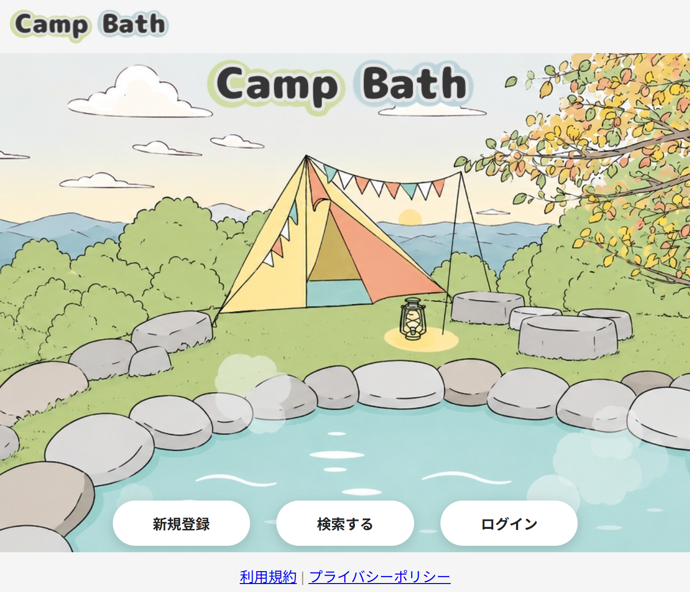

### 3-2. 地方選択・都道府県選択・エリア選択画面

地方・都道府県・エリアを順番に選択して、検索する地域を絞り込みます。

地方選択画面では「現在地から検索」を利用してGPSで現在地を取得し、現在地周辺のキャンプ場を検索することもできます。

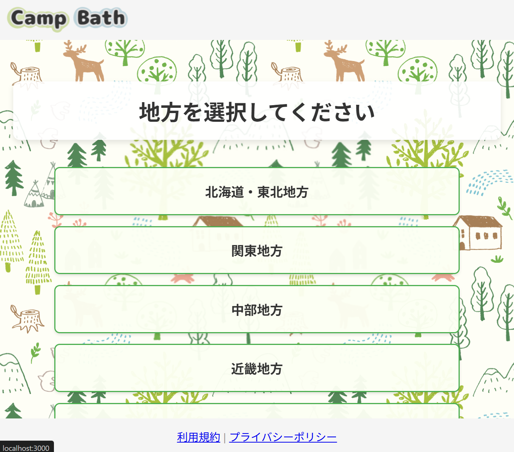

### 3-3. 地図上でのキャンプ場検索

Google Mapsを利用し、地図上にキャンプ場のマーカーを表示します。

地図を操作しながらキャンプ場を探すことができ、気になる施設を選択すると施設情報を確認できます。

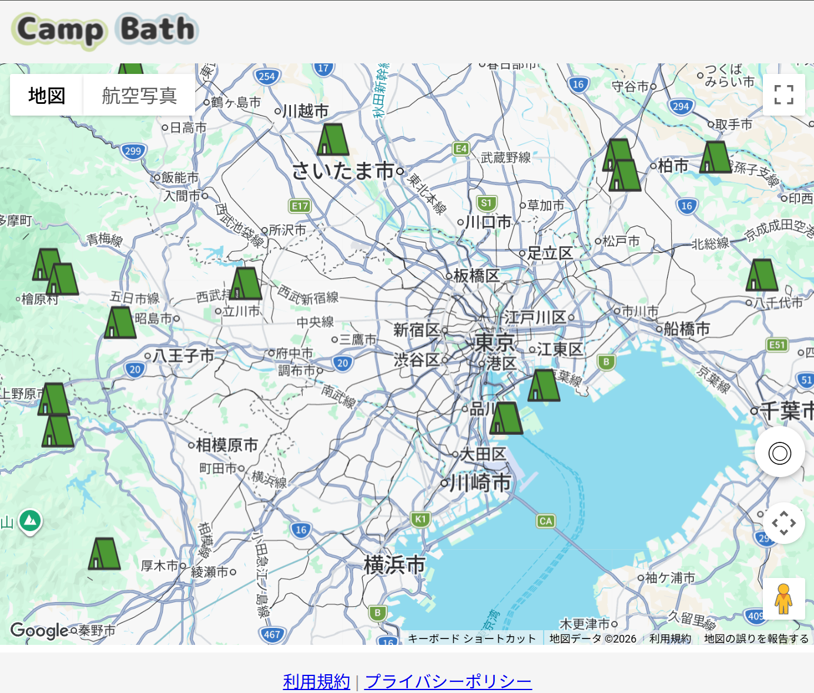

### 3-4. 周辺施設の検索

選択したキャンプ場の周辺にある温泉や商業施設を検索できます。

- 温泉
- 商業施設（コンビニ・スーパー）

キャンプ場と周辺施設を同じ地図上に表示することで、位置関係を比較しながら施設を選択できます。

### 3-5. 施設情報・写真の表示

選択したキャンプ場や周辺施設について、取得可能な施設情報を表示します。

キャンプ場についてはGoogle Places APIから取得した写真も表示し、施設のイメージを確認できます。

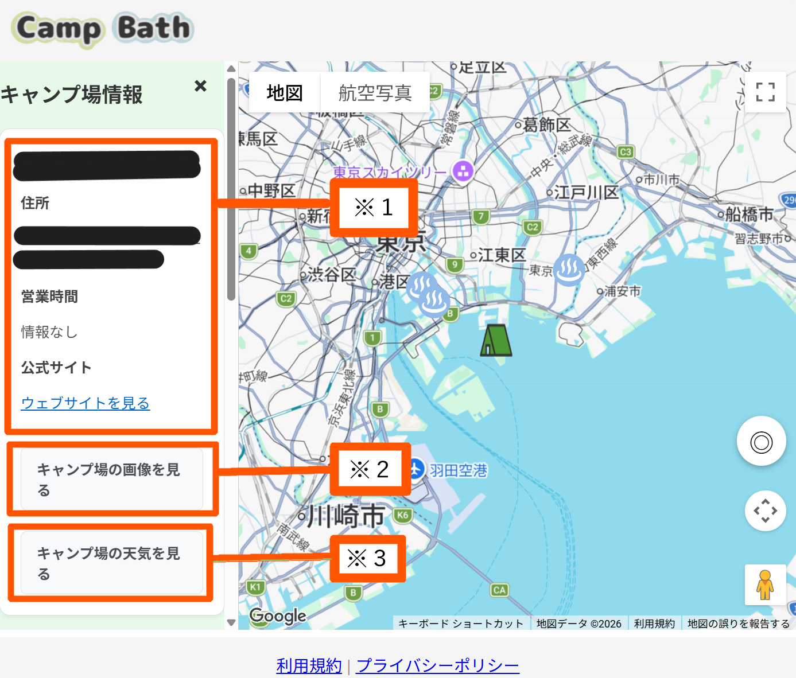

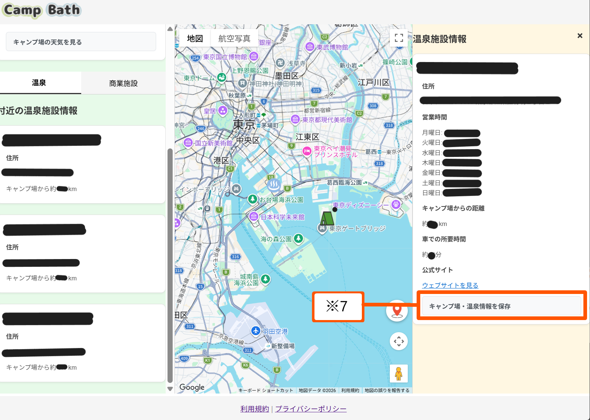

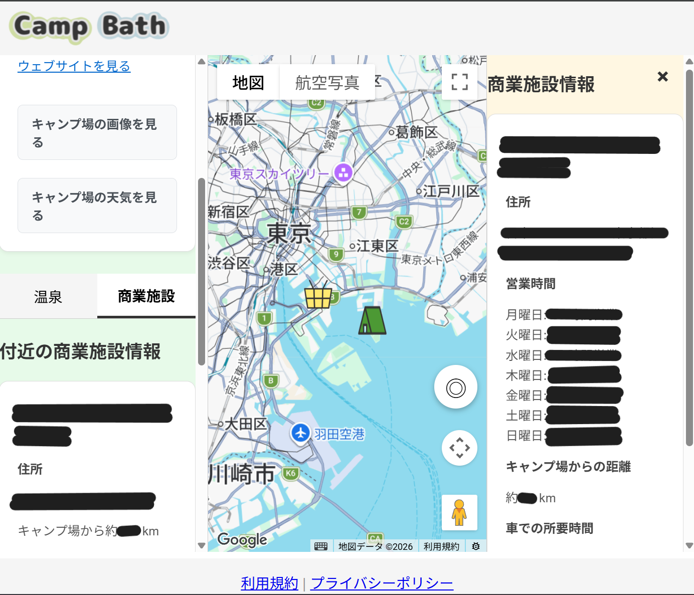

### 3-6. ルート検索・移動距離の表示

Google Routes APIを利用し、キャンプ場と選択した周辺施設間の自動車での移動距離と所要時間を表示します。

施設の位置だけでなく、実際の移動にかかる時間も確認できるため、キャンプ当日の行動計画を立てやすくなります。

### 3-7. キャンプ場周辺の天気表示

Open-Meteo APIを利用し、選択したキャンプ場周辺の天気情報を表示します。

前日分の気象データと、当日を含む7日間の予報を取得し、最高・最低気温や降水確率などを確認できます。

### 3-8. 現在地からの検索

GPSによる現在地取得に対応しています。

現在地を基準にキャンプ場を検索できるため、地図上で地域を選択する方法だけでなく、現在地周辺からも施設を探せます。

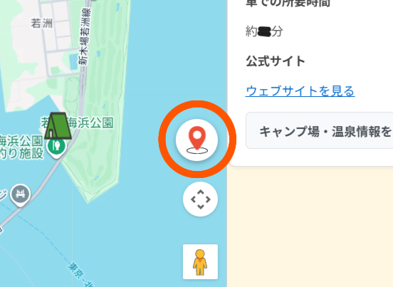

### 3-9. お気に入り機能

ログインユーザーは、キャンプ場と温泉の組み合わせをお気に入りとして保存できます。

お気に入り一覧から保存した組み合わせを再確認でき、不要になった組み合わせは削除できます。

施設名などはGoogle Places APIから取得し、データベースにはユーザーIDと各施設のPlace IDを保存する設計にしています。

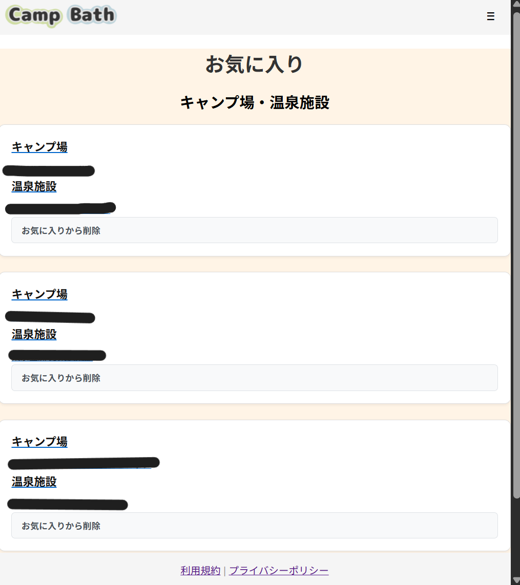

## 4. 技術スタック

| 分類 | 技術 |
|---|---|
| 言語 | Ruby 3.3.8 / JavaScript / HTML / CSS |
| フレームワーク | Ruby on Rails 8.1.3.1 |
| データベース | PostgreSQL |
| 開発環境 | Docker / Docker Compose |
| 認証 | Devise |
| フロントエンド | Importmap / Hotwire（Turbo・Stimulus） |
| 地図表示 | Google Maps JavaScript API |
| 施設検索・情報取得 | Google Places API（Legacy / New） |
| ルート検索 | Google Routes API |
| 天気情報 | Open-Meteo API |
| テスト | RSpec / FactoryBot / Capybara / Selenium |
| コード品質・セキュリティ | RuboCop / Brakeman |
| エラー監視 | Sentry |
| CI | GitHub Actions |
| デプロイ | Render |

## 5. システム構成

### インフラ・開発フロー

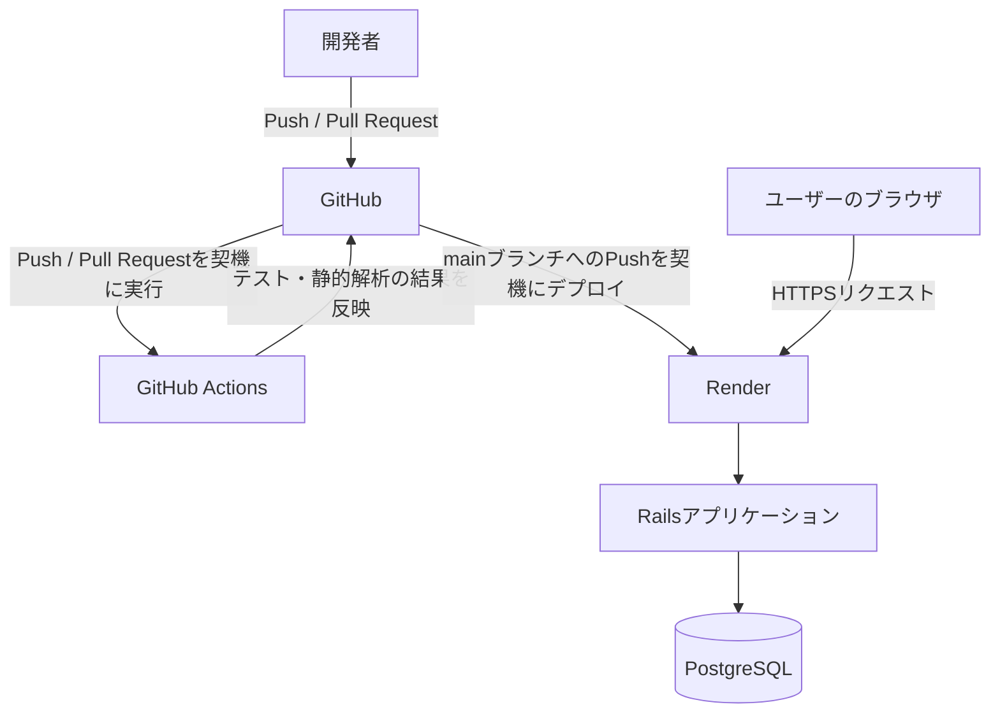

### 外部APIとの連携

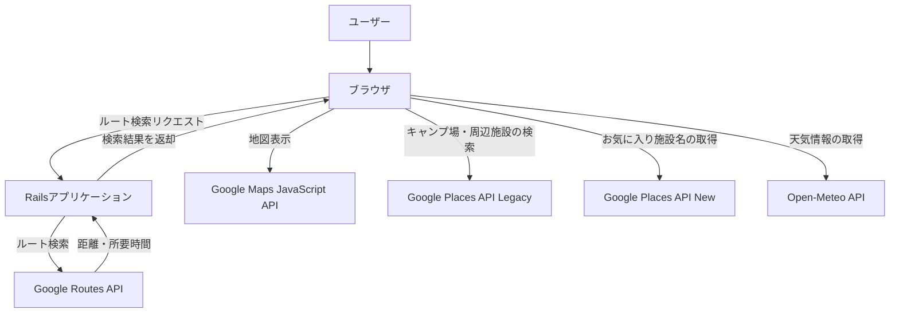

地図表示や施設検索、天気情報の取得は主にブラウザ側で行い、ルート検索はRailsを経由してGoogle Routes APIを利用しています。

また、GitHub Actionsによるテスト・静的解析と、GitHubからRenderへのデプロイを連携させています。

## 6. データベース設計

### ER図

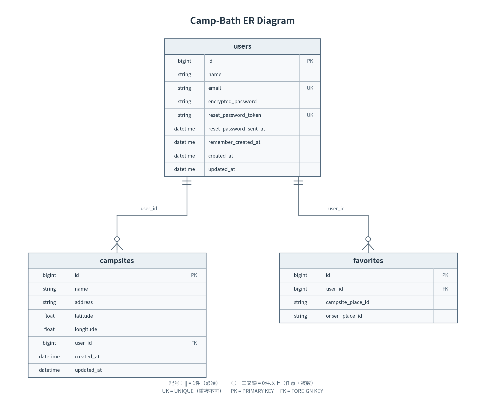

お気に入り機能では、ユーザーとキャンプ場・温泉の組み合わせを関連付けて保存します。

Google Places APIから取得した施設情報をすべてデータベースに保存するのではなく、施設を識別するPlace IDを保存し、施設名などの情報は必要に応じてAPIから取得する設計にしています。

また、同じユーザーが同じキャンプ場と温泉の組み合わせを重複して登録できないよう、複合ユニークインデックスを設定しています。

## 7. 技術的な工夫・実装で取り組んだこと

### 7-1. 複数の外部APIを連携した地図検索

Camp-Bathの中心となる機能として、Google Maps Platformの複数のAPIを連携させた地図検索を実装しました。

- Google Maps JavaScript API：地図の表示・操作
- Google Places API（Legacy）：キャンプ場や周辺施設の検索、施設情報・写真の取得
- Google Places API（New）：お気に入り一覧での施設名の取得
- Google Routes API：施設間の移動距離・所要時間の算出

それぞれのAPIの役割を分け、地図上での検索から施設情報の確認、移動時間の把握までを一連の操作で行えるようにしました。

### 7-2. キャンプ場と周辺施設を同時に比較できるUI

キャンプ場を選択した際に、周辺の温泉や商業施設も地図上に表示することで、施設同士の位置関係を確認しやすくしました。

また、施設の選択や表示をアイコン中心の操作にすることで、検索条件を文字入力する負担を減らし、直感的に操作できるように工夫しました。

### 7-3. お気に入り機能のデータ設計

お気に入り機能では、キャンプ場単体ではなく、キャンプ場と温泉の組み合わせを一つの単位として保存する設計にしました。

同じキャンプ場でも、利用する温泉によってキャンプ計画は変わります。そのため、2つのPlace IDを組み合わせて保存し、後から同じ組み合わせを再確認できるようにしています。

### 7-4. 外部APIの利用を考慮した構成

Google Routes APIの呼び出しはRails側で行い、APIキーをブラウザ側に直接公開しない構成にしています。

また、地図・施設情報・天気情報など、用途ごとに利用するAPIを分けることで、機能の役割を整理しました。

## 8. 画面遷移図

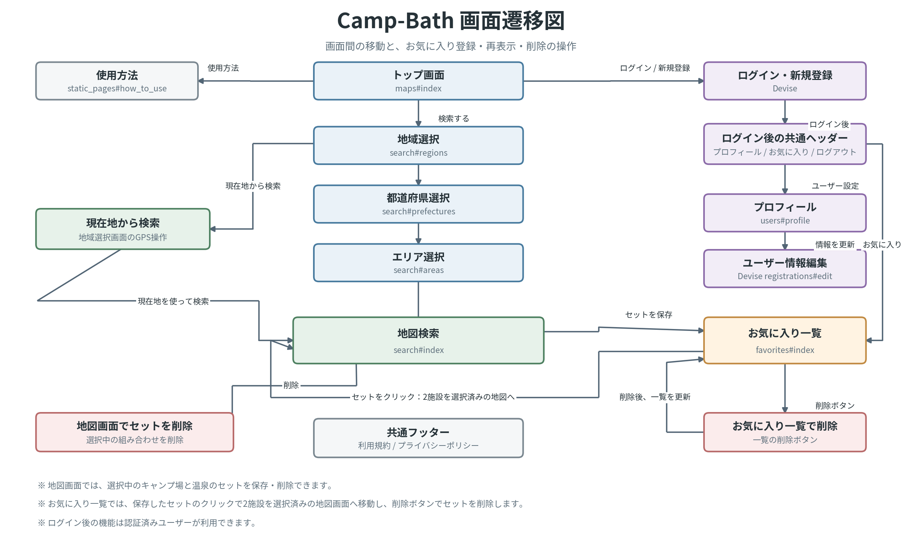

## 9. 開発環境の構築

### 前提条件

- Git
- Docker
- Docker Compose

### セットアップ手順

リポジトリをクローンします。

```bash
git clone https://github.com/wt621/Camp_Bath.git
cd Camp_Bath
```

環境変数ファイルを作成します。

```bash
cp .env.example .env
```

`.env`を開き、必要な環境変数を設定してください。

```env
GOOGLE_MAPS_API_KEY=your_google_maps_api_key
GOOGLE_ROUTES_API_KEY=your_google_routes_api_key
SELENIUM_DRIVER_URL=http://chrome:4444/wd/hub
SENTRY_DSN=your_sentry_dsn
```

Google Maps APIとGoogle Routes APIを利用するため、それぞれのAPIキーを設定してください。Sentryを利用しない場合は、`SENTRY_DSN`は空欄でも構いません。

データベースとChromeコンテナを起動します。

```bash
docker compose up -d db chrome
```

データベースを準備します。

```bash
docker compose run --rm web bin/rails db:prepare
```

Webコンテナを起動します。

```bash
docker compose up -d web
```

ブラウザで以下にアクセスしてください。

http://localhost:3000/

### 開発環境の停止

```bash
docker compose down
```

※ `docker compose down -v` はデータベースのボリュームも削除するため、通常の停止時には使用しないでください。

## 10. テスト・品質管理

### RSpec

RSpecを使用して、モデル・リクエスト・システムテストを実施しています。

**テスト実行結果：47 examples / 0 failures**

テストを実行するには、Webコンテナが起動している状態で以下を実行します。

```bash
docker compose exec -e RAILS_ENV=test web bundle exec rspec
```

テストでは、FactoryBotによるテストデータの作成や、Capybara・Seleniumによるブラウザ操作を利用しています。

SimpleCovを使用してテストカバレッジを測定し、RSpec実行時にレポートを生成します。

**ラインカバレッジ：79.83%**

カバレッジレポートは以下に出力されます。

```text
coverage/index.html
```

### GitHub Actions

GitHub Actionsを利用し、Pull Request作成時とmainブランチへのPush時に自動チェックを実行しています。

主なチェック内容は以下のとおりです。

| チェック | 内容 |
|---|---|
| RSpec | 自動テスト |
| Brakeman | Railsアプリケーションのセキュリティ静的解析 |
| Importmap audit | JavaScript依存関係の脆弱性チェック |
| RuboCop | Rubyコードの静的解析・スタイルチェック |

RSpecの実行環境にはPostgreSQLとChromeを使用しています。

## 11. 技術選定の理由

### Google Maps Platform

Camp-Bathでは、キャンプ場の検索だけでなく、周辺の温泉や商業施設の検索、施設情報の取得、移動距離・所要時間の算出までを実現する必要がありました。

Google Maps Platformは、地図表示・施設検索・経路計算を組み合わせられるため、今回のサービスの目的に適していると考え採用しました。

### Google Maps Platform・Mapbox・Leafletの比較

| 比較項目 | Google Maps Platform | Mapbox | Leaflet |
|---|---|---|---|
| 施設情報の検索 | Places APIで対応 | 外部サービス等との連携が必要 | 外部サービス等との連携が必要 |
| ルート検索 | Routes APIで対応 | Directions API等で対応 | 外部サービス等との連携が必要 |
| 地図のカスタマイズ | 対応 | 豊富なスタイル設定に対応 | 地図タイルやプラグインで対応 |
| 特徴 | 地図・施設検索・経路計算を組み合わせやすい | 地図デザインの自由度が高い | オープンソースで柔軟に構築できる |

Camp-Bathでは、独自の地図デザインを追求することよりも、周辺施設の情報を取得し、利用者が位置関係を直感的に把握できることを重視しました。

そのため、必要な機能をまとめて連携できるGoogle Maps Platformを選択しました。

### PostgreSQL

開発環境と本番環境のデータベースを統一し、環境の違いによる不具合を減らすためPostgreSQLを採用しました。
SQLiteは軽量で導入が簡単という利点がありますが、今回は本番環境のRenderで使用されているPostgreSQLを開発環境から利用することで、環境差異を抑えることを重視しました。

### Render

RenderはGitHubとの連携によるデプロイが可能で、Railsアプリケーションとデータベースを同じプラットフォーム上で管理できるため採用しました。

## 12. 今後の改善・展望

- **ルートの地図上への描画：** Routes APIから取得したルート情報を利用し、キャンプ場から周辺施設までの経路を地図上に表示する。
